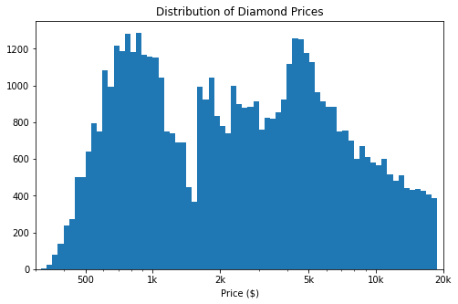
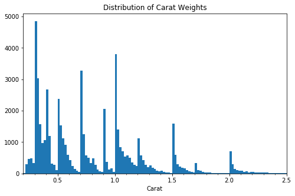
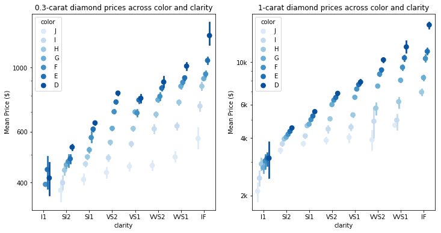

# What You Will Create

The following is a simplified example of the expected project deliverables based on the Diamond dataset used throughout this course.

## Part 1: Diamonds Exploratory analysis

This document explores a data set containing prices and attributes for approximately 54,000 round-cut diamonds.

### Preliminary Wrangling

Here we will look at the raw data, and convert cut, color, and clarity into ordered categorical types:


<center>Printing data frame shape, data types, and categorically encoding features.</center>

**What is the structure of your dataset?**

There are 53,940 diamonds in the dataset with ten features (carat, cut, color, clarity, depth, table, price, x, y, and z). Most variables are numeric in nature, but the variables cut, color, and clarity are ordered factor variables with the following levels.

```txt
(worst) ——> (best)
cut: Fair, Good, Very Good, Premium, Ideal
color: J, I, H, G, F, E, D
clarity: I1, SI2, SI1, VS2, VS1, VVS2, VVS1, IF
```

### 1. Univariate exploration

Let's look at the distribution of price. Here we see a long tailed distribution. This is a contender for a log-transform.


<center>Histogram of price ($). Note the long right skewed tail.</center>

Price has a long-tailed distribution, with a lot of diamonds on the low price end, and few on the high price end. Interestingly, there's a steep jump in frequency right before 2000, rather than a smooth ramp up.

### 2. Bivariate analysis

Let's start by looking at the price distributions for cut, color, and clarity. This is using a series of boxplots and PairGrid, with a ranodm sample of 2000 diamonds.


<center>Pricing (top) and caret (bottom) distributions against diamont cut, color, and clarity.</center>

Interestingly, it appears that there are some negative relationships between the categorical variables and the two numeric variables of interest. The diamonds with the best features (Ideal cut, color D, clarity IF) seem to get the lowest prices, but also tend to be smaller on average. This will be worth investigating more later on, using the full data.

Finally, let's look at relationships between the three categorical features.

### 3. Multivariate analysis

The main thing I want to explore in this part of the analysis is how the three categorical measures of quality play into the relationship between price and carat.

I looked at FacetGrid's for each combination of Price vs. Carat, with encoding for diamont cut, clarity, and color encoded by color. Each of these faceted heat maps shows the relationship of quality level against price and diamont size. However, this relationship is clearest in the clarity plot (shown here).


<center>Faceted heat map of price ($) vs diamond size (carats). Facets provide clarity grade.</center>

**Talk about some of the relationships you observed in this part of the investigation. Were there features that strengthened each other in terms of looking at your feature(s) of interest?**

I extended my investigation of price against diamond size in this section by looking at the impact of the three categorical quality features. The multivariate exploration here showed that there indeed is a positive effect of increased quality grade on diamond price, but in the dataset, this is initially hidden by the fact that higher grades were more prevalent in smaller diamonds, which fetch lower prices overall. Controlling for the carat weight of a diamond shows the effect of the other C's of diamonds more clearly. This effect was clearest for the color and clarity variables, with less systematic trends for cut.

## Part 2: Diamonds Explanatory Analysis

### Investigation Overview

In this investigation, I wanted to look at the characteristics of diamonds that could be used to predict their prices. The main focus was on the four Cs of diamonds: carat (weight), cut grade, color grade, and clarity grade.

### Dataset Overview

The data consisted of prices and attributes of approximately 54,000 round-cut diamonds. The attributes included the four Cs of diamonds, as well as additional measurements such as table, depth, and dimensions. Thirty-nine data points were removed from the analysis due to inconsistencies or missing information.

### Distribution of Diamond Prices

Diamond prices in the dataset take on a very large range of values, from about $300 at the lowest, to about $19,000 at the highest. Plotted on a logarithmic scale, the distribution of diamond prices takes on a multimodal shape.



### Distribution of Carat Weights

Carat is a measure of a diamond's weight, where 1 carat is equivalent to 0.2 grams. A large proportion of diamonds take on carat sizes to one decimal place (e.g. 0.3, 0.7, 1.0) or slightly larger, with gradually decreasing frequencies until the next peak is reached.



### Price by Color and Clarity for Selected Carat Weights

We can see how color and clarity grades affect diamond price by plotting the average price on selected carat weights: those around 0.3 carats and those around 1 carat. For both the 0.3-carat and 1.0-carat diamonds, as the clarity level increases, the general height of the points rises, showing an increase in price. Within each level of clarity, we also observe an increase in price based on the color grade (J is lowest, D is highest).


